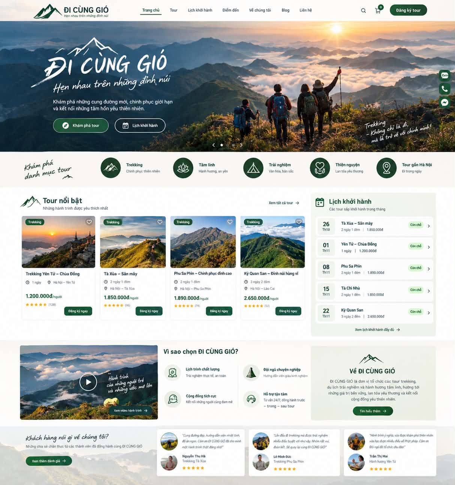

# 🏔️ TREKKING ĐI CÙNG GIÓ – "Khám phá thiên nhiên, chinh phục mọi giới hạn"
> **Web Demo Interactive Prototype** cho công ty du lịch lữ hành chuyên tour trekking, du lịch trải nghiệm, hành hương tâm linh và thiện nguyện.

🔗 **Trang web đang chạy trực tiếp tại:** [https://lucvuu.github.io/di-cung-gio/](https://lucvuu.github.io/di-cung-gio/)

Dự án được xây dựng theo kiến trúc **Zero-build Static Web**, chạy trực tiếp trên trình duyệt và tự động triển khai 100% lên **GitHub Pages** thông qua GitHub Actions.



---

## 🎨 Nhận Diện Thương Hiệu (Brand Identity)

- **Thương hiệu:** TREKKING ĐI CÙNG GIÓ
- **Slogan:** *"Khám phá thiên nhiên, chinh phục mọi giới hạn"*
- **Thông điệp đồng hành:** *"Hẹn nhau trên những đỉnh núi"*
- **Địa chỉ:** 126 Trần Tử Bình, Cầu Giấy, Hà Nội
- **Hotline hỗ trợ:** 0965 983 302
- **Màu sắc chủ đạo:**
  - **Forest Green (Primary):** `#1E4D3B` (Nút bấm chính, icon danh mục, giá tiền, điểm nhấn thương hiệu)
  - **Mint Soft (Secondary):** `#E6F4EA` / `#EBF2EA` (Badge "Còn chỗ", nền khối Về ĐI CÙNG GIÓ)
  - **Warm Cream (Background):** `#F6F7F2` (Nền trang kem ngà dịu mắt)
  - **Amber Gold (Rating):** `#F59E0B` (Sao đánh giá chất lượng dịch vụ)
- **Typography:**
  - Font viết tay nghệ thuật: Google Font **Caveat** & **Dancing Script** (Hỗ trợ tiếng Việt trọn vẹn).
  - Font nội dung & giao diện: **Plus Jakarta Sans** & **Montserrat**.

---

## ✨ Cấu Trúc Giao Diện & Tính Năng Tương Tác

### 1. Sticky Header
- Logo núi rừng màu xanh `#1E4D3B` + Tên thương hiệu "ĐI CÙNG GIÓ" + Slogan phụ "Hẹn nhau trên những đỉnh núi".
- Menu điều hướng mượt mà: *Trang chủ*, *Tour*, *Lịch khởi hành*, *Điểm đến*, *Về chúng tôi*, *Blog*, *Liên hệ* (tự động highlight theo vị trí cuộn trang).
- Nút tìm kiếm nhanh, nút giỏ hàng / yêu thích có badge số lượng nhảy linh hoạt, nút CTA bo tròn `Đăng ký tour`.
- Menu hamburger trượt êm ái trên màn hình di động (Mobile Drawer).

### 2. Hero Section
- Ảnh nền full-width chất lượng cao cảnh bình minh biển mây đỉnh núi Tây Bắc.
- Chữ nghệ thuật "ĐI CÙNG GIÓ" kết hợp slogan viết tay uốn lượn.
- 2 Nút CTA: `Khám phá tour` (icon la bàn) và `Lịch khởi hành` (icon lịch).
- Góc phải dưới: Câu trích dẫn nghiêng nghệ thuật: *"Trekking – Không chỉ là đi, mà là trở về với chính mình!"*.
- **Floating Action Bar (Cố định góc phải màn hình):** 3 nút tròn thao tác nhanh: `Zalo` (chat trực tiếp), `Gọi điện` (hotline 24/7 với hiệu ứng pulse), và `Messenger`.

### 3. Khám Phá Danh Mục Tour (Category Bar)
- Tiêu đề viết tay cùng mũi tên vẽ tay cá tính.
- 5 danh mục tour với icon tròn xanh đậm đặc trưng:
  1. **Trekking** – Chinh phục thiên nhiên
  2. **Tâm linh** – Hành hương, an yên
  3. **Trải nghiệm** – Văn hóa, bản sắc
  4. **Thiện nguyện** – Lan tỏa yêu thương
  5. **Tour gần Hà Nội** – Đi trong ngày
- *Tính năng tương tác:* Click vào từng danh mục sẽ kích hoạt hiệu ứng active và lọc danh sách tour tương ứng ngay lập tức.

### 4. Main Content (Bố Cục 7:3 Chuẩn Thiết Kế)
- **Cột trái (70%): Tour nổi bật**
  - Lưới thẻ tour hiển thị hình ảnh 100% cảnh sắc Việt Nam sắc nét, badge phân loại `Trekking`, huy hiệu độ cao (`1.068m`, `2.865m`, `2.868m`, `3.046m`), nút thả tim yêu thích, thời lượng, cung đường, mức giá nổi bật và đánh giá 5 sao.
  - Mô tả tóm tắt 1 dòng súc tích (`shortSummary`) giới thiệu tinh thần hành trình.
  - Nút `📖 Câu chuyện` mở nhanh câu chuyện lịch sử và huyền tích của từng đỉnh núi.
  - Lớp phủ kính mờ khi hover: *"📍 Lộ trình & Lịch sử vùng đất → Bấm để khám phá"*.
  - Các tour chủ lực:
    - *Trekking Yên Tử – Chùa Đồng* (1 ngày | 1.200.000đ/người | 1.068m)
    - *Tà Xùa – Săn mây* (2 ngày 1 đêm | 1.850.000đ/người | 2.865m)
    - *Phu Sa Phin – Chinh phục đỉnh cao* (2 ngày 1 đêm | 1.890.000đ/người | 2.868m)
    - *Kỳ Quan San – Đỉnh núi hùng vĩ* (3 ngày 2 đêm | 2.650.000đ/người | 3.046m)
    - *Tà Chì Nhù – Mùa Hoa Chi Pâu* (2 ngày 1 đêm | 1.850.000đ/người | 2.979m)
- **Cột phải (30%): Widget Lịch khởi hành**
  - Khối lịch trình 5 dòng tour sắp khởi hành: Ô ngày tháng riêng biệt, tên tour, thời lượng, giá tour và badge `Còn chỗ` xanh ngọc nhẹ nhàng.
  - Bấm vào bất kỳ dòng lịch trình nào sẽ tự động mở Modal chi tiết hành trình và điền sẵn tour.

### 5. Vì Sao Chọn Chúng Tôi & Về ĐI CÙNG GIÓ (3 Cột Ngang)
- **Cột 1 (Banner Video):** Ảnh núi non hùng vĩ, chữ viết tay *"Hành trình của những người trẻ và những ước mơ lớn"*, nút play phát video popup có hiệu ứng sóng lan tỏa.
- **Cột 2 (Vì sao chọn ĐI CÙNG GIÓ?):** Lưới 2x2 nêu bật 4 giá trị cốt lõi:
  - *Lịch trình chất lượng*
  - *Đội ngũ chuyên nghiệp*
  - *Cộng đồng tích cực*
  - *Hỗ trợ tận tâm 24/7*
- **Cột 3 (Về ĐI CÙNG GIÓ):** Khối nền xanh ngọc `#EBF2EA` sang trọng, icon đỉnh núi tuyết, lời giới thiệu sứ mệnh và nút `Tìm hiểu thêm ->`.

### 6. Khách Hàng Nói Gì Về Chúng Tôi (Testimonials)
- Tiêu đề viết tay bên trái cùng nút `Xem thêm đánh giá ->`.
- 3 thẻ nhận xét thực tế kèm ảnh đại diện tròn, nội dung chia sẻ cảm xúc và chấm điểm 5 sao từ khách hàng:
  - Nguyễn Thu Hà (*Trekking Tà Xùa*)
  - Lê Minh Đức (*Trekking Phu Sa Phin*)
  - Trần Thị Mai (*Hành hương Yên Tử*)

### 7. Các Popup & Modal Tương Tác Sống Động
- **Modal Chi Tiết Tour (Professional Storytelling Modal):**
  - **Header:** Ảnh bìa lớn của đúng đỉnh núi đó + Badge độ cao + Badge độ khó + Tên tour & Giá tiền.
  - **Khối 1 – 🗺️ Hành trình đi đâu? (Lộ trình địa lý):** Sơ đồ các chặng nối tiếp nhau (Visual Route Steps: `Hà Nội` → `...` → `Đỉnh...`) và lộ trình địa lý chi tiết.
  - **Khối 2 – 📜 Lịch sử & Câu chuyện vùng đất:** Đặt trong khung nền màu kem ấm (`bg-[#F6F7F2] border-l-4 border-[#1E4D3B]`) trình bày trang trọng lịch sử, nguồn gốc tên gọi và văn hóa bản địa.
  - **Khối 3 – 🎒 Lịch trình từng ngày & Chuẩn bị:** Lịch trình chi tiết và danh sách đồ dùng cá nhân.
  - **Footer:** Nút lớn `Đăng ký chinh phục ngay` kết nối thẳng với Form đăng ký.
- **Modal Đăng Ký Tour Thông Minh:** Bộ tính giá tự động theo số khách, giảm 5% cho nhóm ≥4 người, kiểm tra SĐT Việt Nam 10 chữ số và tạo mã đặt chỗ ngẫu nhiên.
- **Toast Notification:** Thông báo xác nhận thành công góc phải màn hình, đóng tự động sau 4-5 giây.
- **Drawer Tour Yêu Thích:** Bấm vào tim trên thẻ tour để thêm vào giỏ yêu thích, lưu `localStorage`.
- **Modal Video:** Phát video hành trình trekking núi rừng thực tế.
- **Modal Tìm Kiếm:** Tìm kiếm tour tức thì theo từ khóa địa danh hoặc tên tour.

---

## 📁 Cấu Trúc Thư Mục

```
Đi cùng gió/
├── index.html                   # Trang giao diện chính
├── assets/
│   ├── css/
│   │   └── style.css            # Custom CSS, font chữ viết tay, hiệu ứng hover/animation
│   └── js/
│       └── main.js              # Xử lý tương tác, dữ liệu tour, modal, toast, lọc danh mục
├── .github/
│   └── workflows/
│       └── deploy.yml           # GitHub Actions tự động deploy lên GitHub Pages
├── 13072e44-4f5b-4d30-bedd-4ab70ee2a78f.jpg  # Hình ảnh thiết kế gốc
└── README.md                    # Tài liệu hướng dẫn
```

---

## 🚀 Hướng Dẫn Chạy Local (Không Cần Cài Đặt Build Tool)

Do đây là dự án **Zero-build Web**, bạn có thể chạy ngay lập tức bằng một trong các cách sau:

### Cách 1: Mở trực tiếp
Nhấp đúp chuột vào file `index.html` để mở trong trình duyệt Chrome, Edge, Firefox hoặc Safari.

### Cách 2: Sử dụng VS Code Live Server
1. Mở thư mục dự án trong VS Code.
2. Cài extension **Live Server** (nếu chưa có).
3. Nhấp chuột phải vào `index.html` và chọn **Open with Live Server**.

### Cách 3: Sử dụng Python Server
Chạy lệnh sau trong PowerShell hoặc Terminal:
```bash
python -m http.server 8000
```
Sau đó truy cập: `http://localhost:8000`

---

## 🌐 Hướng Dẫn Bật GitHub Pages Sau Khi Push Lên GitHub

Workflow tự động `.github/workflows/deploy.yml` đã được cấu hình sẵn chuẩn GitHub Actions. Bạn chỉ cần thực hiện 3 bước đơn giản:

1. **Tạo Repository mới trên GitHub** (ví dụ: `di-cung-gio`).
2. **Push mã nguồn lên GitHub:**
   ```bash
   git remote add origin https://github.com/<username>/di-cung-gio.git
   git branch -M main
   git push -u origin main
   ```
3. **Kích hoạt GitHub Pages:**
   - Vào repository trên GitHub -> Click tab **Settings**.
   - Tại menu bên trái, chọn **Pages**.
   - Tại mục **Build and deployment** -> **Source**: Chọn **GitHub Actions**.
   - GitHub Actions sẽ tự động kích hoạt tiến trình deploy trong tab **Actions**.
   - Khi hoàn thành, trang web của bạn sẽ hiển thị trực tuyến tại:
     ```
     https://<username>.github.io/di-cung-gio/
     ```

---

## 🛠️ Công Nghệ Sử Dụng

- **HTML5:** Semantic HTML, accessibility, meta tags chuẩn SEO.
- **Tailwind CSS (CDN):** Thiết kế responsive, layout utility classes hiện đại.
- **Google Fonts:** `Caveat`, `Dancing Script`, `Plus Jakarta Sans`, `Montserrat`.
- **Lucide Icons:** Bộ icon vector sắc nét, chuẩn UI/UX.
- **Vanilla JavaScript (ES6+):** Xử lý logic nhẹ nhàng, không phụ thuộc framework cồng kềnh, tốc độ tải trang cực nhanh.
- **GitHub Actions:** CI/CD pipeline tự động hóa triển khai GitHub Pages.

---
*TREKKING ĐI CÙNG GIÓ © 2026 – Khám phá thiên nhiên, chinh phục mọi giới hạn.*
*Địa chỉ: 126 Trần Tử Bình, Cầu Giấy, Hà Nội | Hotline hỗ trợ: 0965 983 302*

